# KIANO POLET

<p align="center">
  
</p>

<p align="center">
  <a href="https://github.com/kpolet2010-hue">
    
  </a>
  
  
</p>

---

## `01` — About Me

```cpp
class Developer {
public:
    std::string name = "Kiano Polet";
    std::string role = "Application Developer";
    std::string location = "Switzerland";

    std::vector<std::string> interests = {
        "Software Engineering",
        "Systems Programming",
        "Backend Architecture",
        "Game Development",
        "Low-Level Computing"
    };

    std::string philosophy =
        "Understand the system. Build it better.";
};
```

I'm an application developer passionate about understanding how software works beneath the surface.

From low-level systems programming and CPU architecture to backend infrastructure and full-stack applications, I enjoy building projects that challenge my technical understanding.

I believe in learning by building, understanding fundamentals and writing software with purpose.

## `02` — Technologies & Tools

<p align="center">
  
</p>

<p align="center">
  
</p>

## `03` — Featured Projects

### CoreSim
**Computer Architecture & CPU Simulation**

A custom CPU simulation project focused on understanding processor architecture, instruction execution, registers, ALU operations and low-level computing.

`C++` `Computer Architecture` `Systems Programming`

### NOSONE
**Game Infrastructure & Backend Engineering**

A game infrastructure project involving authentication, matchmaking, player management, statistics and backend services.

`Java` `Spring Boot` `PostgreSQL` `Infrastructure`

---

## `04` — GitHub Statistics

<p align="center">
  
  
</p>

<p align="center">
  
</p>

---


## `05` — Contribution Activity



<p align="center">
  
</p>


---

## `06` — Currently Exploring

- C++ and systems programming
- CPU architecture and computer organization
- Backend architecture and distributed systems
- Infrastructure and cloud engineering
- Software design and engineering principles

---

## `07` — Current Focus

```text
[ ACTIVE ] CoreSim — CPU Architecture
[ ACTIVE ] C++ — Systems Programming
[ LEARNING ] Computer Architecture
```

**B. GitHub Trophies**

<p align="center">
  
</p>

---

<p align="center">
  
  <br/><br/>
  <i>“Understand the system. Build beyond its limits.”</i>

  <br/><br/>

  

  <br/><br/>

  <sub>Designed & built by Kiano Polet · Switzerland</sub>
</p>
